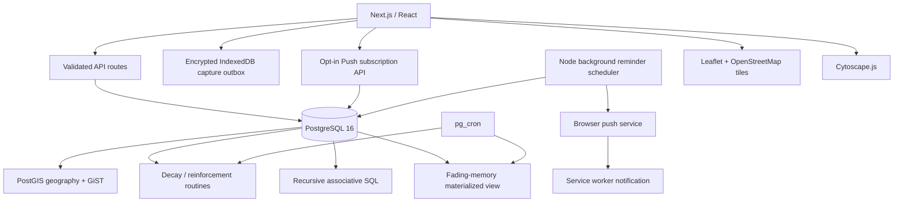

# System architecture

Next.js TypeScript interfaces call parameterized route handlers. The handlers validate request shape and use `node-postgres`; SQL routines own spatial filtering, route ordering, decay, reinforcement, graph traversal, and fading review. No ORM, embedding service, paid API, or graph database is used.

Migration 013 adds combined route/event-time retrieval and alternate activation-path traversal. The `/research/spatiotemporal` view visualizes route/window results; `/graph` requests alternate simple paths from PostgreSQL. The research runner evaluates the production functions with a rollback-only, labeled fixture and writes measured ablation/calibration/robustness artifacts.

Docker Compose binds app and database ports to loopback and persists PostgreSQL data in a named volume. OSM tiles and Web Push relays need internet access; memory data and recall algorithms remain in PostgreSQL. Optional single-user authentication can protect the app; deployment beyond a trusted local machine requires it plus reviewed authorization, TLS, managed secrets, and database network controls.
