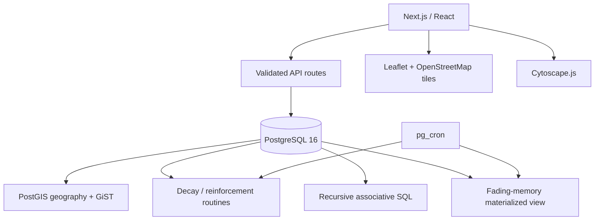

# System architecture

Next.js TypeScript interfaces call parameterized route handlers. The handlers validate request shape and use `node-postgres`; SQL routines own spatial filtering, route ordering, decay, reinforcement, graph traversal, and fading review. No ORM, embedding service, paid API, or graph database is used.

Docker Compose binds app and database ports to loopback and persists PostgreSQL data in a named volume. OSM tile retrieval needs internet access; memory data and algorithms stay local. There is no authentication: deployment beyond a trusted local machine requires authentication, authorization, TLS, and network/database access controls.
