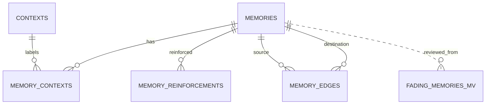

# MemoryScape entity relationships

`memory_contexts` is the normalized many-to-many join relation. `memory_edges` stores directed, weighted associations between two memory rows. The fading view is derived and is not an independent source of truth.
